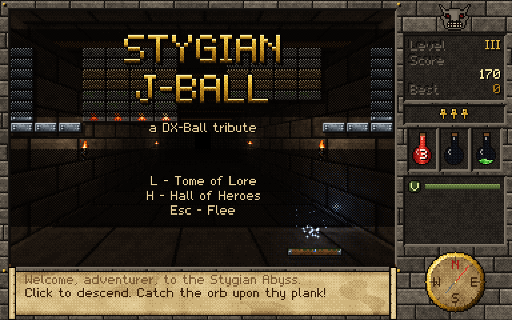
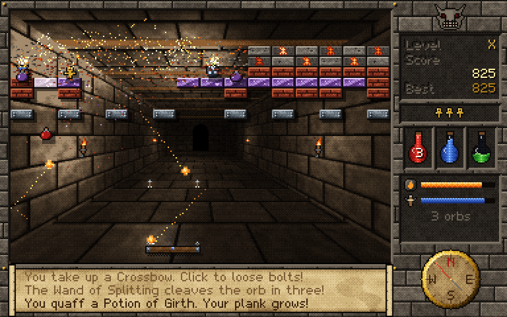
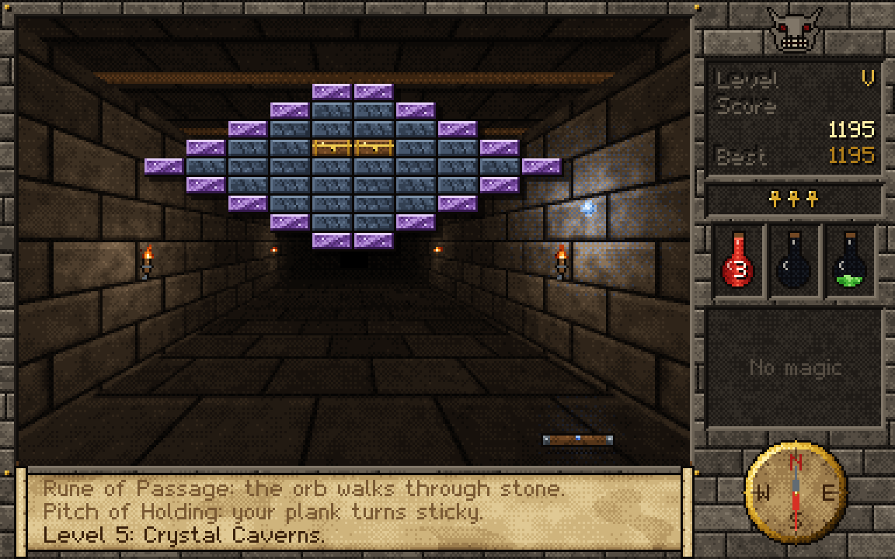
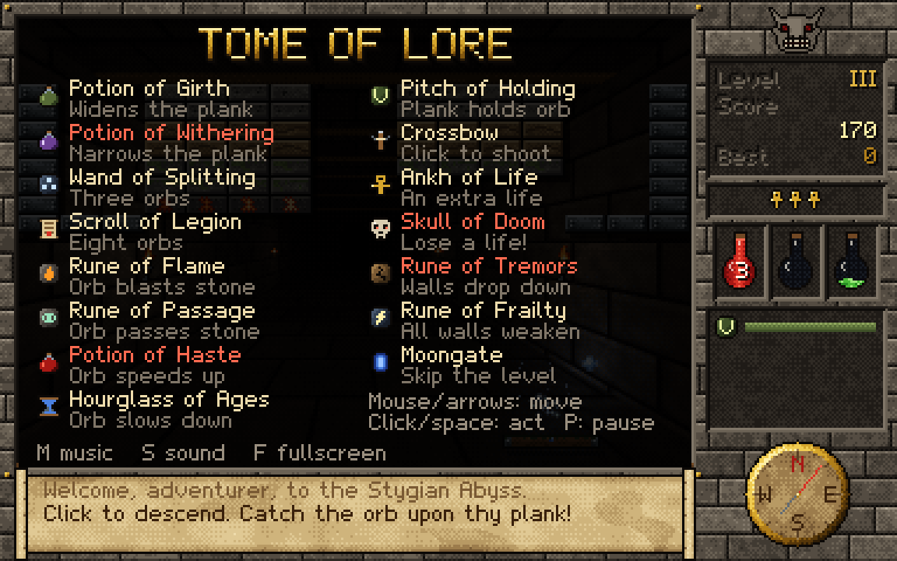

# Stygian J-Ball

A DX-Ball clone written in Rust. The ball/paddle/brick physics follow DX-Ball. The
presentation is pixel art in the style of *Ultima Underworld*: a torch-lit dungeon
corridor behind the bricks, a carved-stone frame, a gargoyle, vitality and mana flasks,
a compass, and a parchment message scroll.

Everything is generated in code. There are no hand-made image or sound files: sprites
are string-art or procedural noise, the corridor is ray-cast once and re-lit with
dithering every frame, and the sound effects and dungeon music are synthesised at
startup.

**[Play it in your browser](https://jptgraczykowski.github.io/stygian-j-ball/)**, on a
computer or on a phone.

| | |
| --- | --- |
|  |  |
|  |  |

The screenshots come from `cargo run --release --bin snapshot`, which renders
scripted scenes with the game's own renderer.

## Playing on a phone

Open [the game's page](https://jptgraczykowski.github.io/stygian-j-ball/) and hold the
phone sideways. To get rid of the browser bars and play offline, add it to your home
screen, where it opens like an app:

- **Android (Chrome):** tap the ⋮ menu, then **Add to Home screen**, then
  **Install**. Chrome may offer to install it on its own with a banner.
- **iPhone or iPad (Safari):** tap the **Share** button (on newer iOS it's in the
  **⋯** menu), then **Add to Home Screen**, then **Add**.

Other browsers have the same option in their menus, usually called *Install* or *Add
to Home screen*. Launch it once while online, and after that it works without a
connection. Touch controls are listed under [Controls](#controls).

## Running

```sh
cargo run --release
```

Rust is pinned in `mise.toml`. On Linux you need the usual X11/Wayland, GL and ALSA
libraries, which most desktops already have.

Options:

| flag | effect |
| --- | --- |
| `--mute` | start with sound and music off |
| `--autoplay` | start a game immediately; the paddle plays itself |
| `--screenshot FILE.png --after SECS` | save a screenshot after SECS seconds, then quit |

### In the browser

The game also builds to WebAssembly and runs in any browser with WebGL:

```sh
./web/build.sh                          # writes target/web
python3 -m http.server -d target/web    # then open http://localhost:8000
```

`target/web` is a static site (an HTML page, the `.wasm` file and macroquad's JS
glue), so any static host can serve it. It has to be served over HTTP; opening
`index.html` from disk won't load the `.wasm`. `mise install` adds the
`wasm32-unknown-unknown` target; without mise, run
`rustup target add wasm32-unknown-unknown`.

In the browser, high scores are kept in the page's `localStorage`, and Esc on the
title screen does nothing, since a game can't close its own tab.

Installing to the home screen (see [Playing on a phone](#playing-on-a-phone)) comes
from `web/manifest.webmanifest`, which asks for fullscreen and landscape, and from
`web/sw.js`, which caches the files for offline play. The service worker fetches from
the network first, so a new deploy shows up on the next launch. The home-screen icons, `web/icon-*.png`, are rendered from the
game's sprites by `cargo run --release --bin icons -- web`.

Every push to `main` rebuilds the site and publishes it to
[GitHub Pages](https://jptgraczykowski.github.io/stygian-j-ball/)
(`.github/workflows/pages.yml`).

## Controls

| input | action |
| --- | --- |
| mouse, or ←/→ (A/D) | move the plank |
| left click, Space or ↑ | launch the orb; fire the crossbow (hold to keep shooting) |
| P / Esc | pause; Esc while paused abandons the run |
| L or F1 | Tome of Lore (what each power-up does) |
| H | Hall of Heroes (high scores) |
| M / S | toggle music / sound effects |
| F or F11 | toggle fullscreen |

On a touch screen, drag anywhere to move the plank and tap to launch or shoot. Tap the
side panel to pause. The title and pause screens show buttons for the Tome of Lore, the
Hall of Heroes, music and sound. To enter a name for the Hall of Heroes, tap the
screen: a phone shows no keyboard for a canvas, so the game asks with the browser's
own dialog. Leaving the tab or locking the phone pauses the game.

High scores are saved to `$XDG_DATA_HOME/stygian-j-ball/scores.tsv` (by default
`~/.local/share/stygian-j-ball/scores.tsv`).

## Physics (from DX-Ball)

- The paddle follows the mouse directly, with no inertia.
- The rebound angle depends only on where the ball hits the paddle. The centre sends it
  straight up and the edges send it out at up to 64°. The incoming angle doesn't matter.
- All balls share one speed. It rises slowly the longer the ball stays in play, and
  resets on a new life or level. Haste and Hourglass power-ups move it up or down.
- Bricks bounce the ball off whichever face it hits. A row of bricks acts as one flat
  surface, and only exposed corners deflect the ball along the corner normal.
- The ball can't travel flatter than 15°, so it never gets stuck going side to side.
  If it loops between walls and iron without progress, it gets a small random nudge.
- The simulation runs at a fixed 240 Hz and sub-steps so the ball moves at most 1 px
  per collision test. It can't tunnel through bricks, even at top speed.
- Brick types: plain stone (1 hit), iron-bound wood (2), crystal (3), indestructible
  iron, fire runes (explode and chain to neighbours), and treasure chests (always drop a
  good power-up).

### Power-ups

| item | effect | | item | effect |
| --- | --- | --- | --- | --- |
| Potion of Girth | wider paddle | | Pitch of Holding | paddle catches the ball |
| Potion of Withering | narrower paddle | | Crossbow | click to shoot bolts |
| Wand of Splitting | each ball splits in three | | Ankh of Life | extra life |
| Scroll of Legion | eight balls | | Skull of Doom | lose a life |
| Rune of Flame | fireball: destroys bricks around each hit | | Rune of Tremors | bricks drop one row |
| Rune of Passage | ball passes through bricks | | Rune of Frailty | all bricks become one-hit |
| Potion of Haste | faster ball | | Moongate | skip the level |
| Hourglass of Ages | slower ball | | | |

There are 14 levels. After the last one you can descend again at a higher speed.

## Code layout

| path | contents |
| --- | --- |
| `src/game.rs` | rules and physics (pure, unit-tested in `src/game/tests.rs`) |
| `src/levels.rs` | level layouts as 16-column strings |
| `src/app.rs` | screen flow, high scores, attract-mode autopilot |
| `src/gfx/` | software 384×240 renderer: palette, dithering, bitmap font, sprites, the ray-cast dungeon, the HUD |
| `src/fx.rs` | particles, transient lights, screen shake, floating text |
| `src/audio.rs` | sound-effect and music synthesis, WAV encoding |
| `src/storage.rs` | high-score persistence: a file natively, `localStorage` in the browser |
| `src/main.rs` | macroquad window, input, audio playback, scaling |
| `src/prompt.rs` | asks for the player's name with the browser's `prompt()` dialog |
| `web/` | browser build: page, `localStorage` and `prompt()` plugins, web app manifest, service worker, icons, build script |
| `src/bin/snapshot.rs` | headless renderer that writes PNG screenshots of scripted scenes |
| `src/bin/icons.rs` | renders the home-screen icons |
| `examples/balance.rs` | an hour of autopilot play, with stats per level |
| `examples/perf.rs` | render timing |

```sh
cargo test --release                              # 50 tests, including a 15-minute autopilot soak
cargo run --release --bin snapshot -- shots       # PNG screenshots in ./shots
cargo run --release --example balance             # balance statistics
```

## License

MIT. See [LICENSE](LICENSE).
